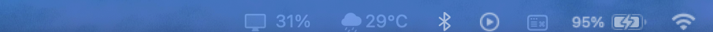
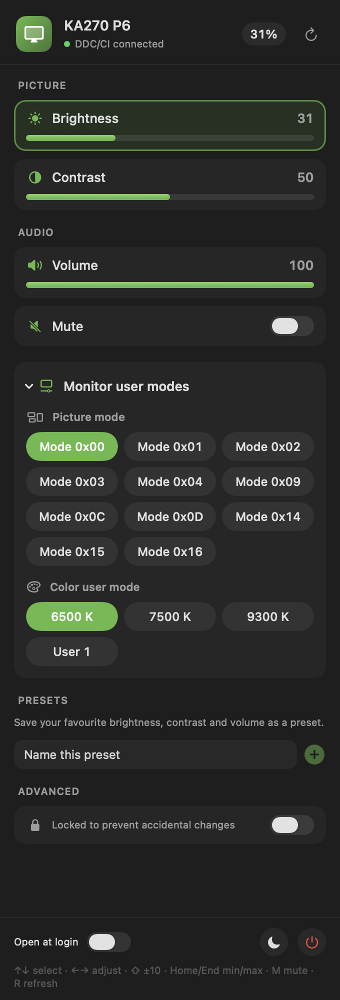

# MonitorWidget

Control your external monitor from the macOS menu bar: brightness, contrast, volume, mute, the monitor's own picture and color user modes, input source, saved presets, and more. No more reaching for the physical buttons.

MonitorWidget talks to the monitor over **DDC/CI**, the same channel the monitor's on-screen menu uses, so changes are made on the monitor itself.





## Features

- **Live brightness in the menu bar**, next to the icon.
- **Picture controls:** brightness, contrast.
- **Audio:** speaker volume and mute.
- **Monitor user modes** (collapsible): picture modes (`0xE2`) and color presets (6500 K, 7500 K, 9300 K, User 1). Picture-mode changes ask for confirmation because the monitor resets brightness and contrast.
- **Presets:** save brightness, contrast and volume as named presets; apply with one click; right-click to delete. Presets never touch color gains or input.
- **Advanced (locked by default):** RGB gains and input source. Unlock with the switch to edit them, so accidental clicks can't upset your color setup.
- **Keyboard control** from the open panel (see below).
- **Quick actions:** sleep the Mac's displays, open at login.
- **Auto-detection:** re-discovers the monitor when displays are plugged, unplugged or rearranged.

## Keyboard shortcuts

Click the menu bar item to open the panel, then use:

| Key | Action |
|---|---|
| ↑ / ↓ | Move between controls |
| ← / → | Adjust the highlighted control by 1 |
| Shift + ← / → | Adjust by 10 |
| Home / End | Jump to minimum / maximum |
| Space or M | Toggle mute (on the Mute row, or anywhere for M) |
| R | Re-read all values from the monitor |

## Requirements

- **Mac:** Apple Silicon (M1 or newer), macOS 14 (Sonoma) or later.
- **Monitor:** an external display with DDC/CI enabled in its on-screen menu. Most monitors have it on by default.
- **Connection:** USB-C or DisplayPort on Apple Silicon. Some Macs' HDMI ports don't support DDC/CI.

**Tested with:** Acer KA270 P6 on an M4 MacBook (macOS 26). Other monitors will show whichever controls they support, but picture-mode labels are monitor-specific. See [Adapting to your monitor](#adapting-to-your-monitor).

## Installation

### Homebrew (recommended)

One-time setup, then install with one command:

```sh
brew tap itsmevizz/monitorwidget https://github.com/itsmevizz/MonitorWidget.git
brew install --cask itsmevizz/monitorwidget/monitorwidget
```

The `monitorctl` command-line tool is installed alongside the app.

To update: `brew upgrade --cask monitorwidget`. To remove: `brew uninstall --cask monitorwidget` (add `--zap` to also remove preferences).

### Download the .dmg

1. Download `MonitorWidget-<version>.dmg` from [Releases](https://github.com/itsmevizz/MonitorWidget/releases).
2. Open the disk image and drag **MonitorWidget** into **Applications**.
3. Launch it from Applications. The first launch may be blocked because the app is not notarized yet: right-click MonitorWidget → **Open** → **Open**. You only need to do this once.

Check the download with the `.sha256` file that comes with the release:

```sh
shasum -a 256 -c MonitorWidget-1.0.1.dmg.sha256
```

### Build from source

Requires Xcode command-line tools (`xcode-select --install`).

```sh
git clone https://github.com/itsmevizz/MonitorWidget.git
cd MonitorWidget
./scripts/build-app.sh          # writes build/MonitorWidget.app and build/MonitorWidget-<version>.dmg
open build/MonitorWidget.app
```

## First run

1. Connect the monitor over USB-C or DisplayPort.
2. Make sure DDC/CI is on in the monitor's on-screen menu.
3. Click the menu bar icon. The panel shows the monitor's name and "DDC/CI connected" when it works.
4. If the icon doesn't appear on macOS 26, open **System Settings → Menu Bar** and allow MonitorWidget to show in the menu bar.
5. To start MonitorWidget at login, switch on **Open at login** in the panel footer.

## Command-line tool (`monitorctl`)

```sh
monitorctl list                 # detected external displays
monitorctl scan                 # capability string and every supported feature's value
monitorctl get brightness       # read one feature
monitorctl set brightness 60    # write one feature
```

Feature names: `brightness`, `contrast`, `volume`, `mute`, `preset`, `red`, `green`, `blue`, `input`, `power`, or a raw code such as `0x10`.

## Adapting to your monitor

MonitorWidget discovers every feature your monitor reports, so brightness, contrast and volume work without configuration. Two things are monitor-specific:

- **Picture mode names.** The monitor reports picture modes as raw codes (for example `0xE2`). MonitorWidget shows them as "Mode 0x.." until they're labelled for your monitor.
- **Vendor-specific codes.** Brands use different codes for extra features.

To check your monitor and make MonitorWidget fit it, use the ready-made prompt in [docs/PORTING_PROMPT.md](docs/PORTING_PROMPT.md). Paste it into an AI coding assistant that can run commands on your Mac.

## How it works

- `Sources/DDCKit/IOAVBridge.swift`: calls Apple's IOAVService functions to reach each external display's DDC/CI channel. These are private APIs, the same ones used by `m1ddc` and MonitorControl.
- `Sources/DDCKit/Monitor.swift`: DDC/CI packet framing, VCP get/set, the chunked capability-string reader, and a write queue that merges slider drags into one write per ~60 ms.
- `Sources/DDCKit/VCP.swift`: VESA MCCS feature codes and their names.
- `Sources/MonitorWidget/`: the AppKit menu bar item and the SwiftUI panel.
- `Sources/monitorctl/`: the command-line tool.

The full settings analysis for the Acer KA270 P6 is in [MONITOR_REPORT.md](MONITOR_REPORT.md).

## Troubleshooting

| Problem | What to try |
|---|---|
| "No external monitor found" | Check the cable is USB-C/DisplayPort (not HDMI on base M1/M2), turn on DDC/CI in the monitor's menu, then click **Retry**. |
| Menu bar icon is missing (macOS 26) | System Settings → Menu Bar → allow MonitorWidget. |
| Values don't update | Click the refresh icon or press R. |
| Controls seem slow | DDC/CI is a slow bus; each write takes about 40–60 ms. Drag more slowly or use the arrow keys. |
| Screen went blank after changing input | Switch the input back using the monitor's physical buttons. |

## Safety notes

- **Input switching** can blank the screen if nothing is connected to the chosen input. The app asks for confirmation; recovery needs the monitor's buttons.
- **Picture-mode switching** resets brightness and contrast on most monitors. The app asks for confirmation and re-reads values afterwards.
- **Factory reset and power-off** are intentionally not exposed.
- Advanced color controls are locked by default.

## Limitations

- Apple Silicon only. Intel Macs use a different display interface that isn't implemented.
- The built-in MacBook display isn't controlled; use macOS's own brightness keys for it.
- The IOAVService calls are private Apple APIs. A future macOS update could change them.
- The app is not yet notarized. See the install notes above.
- macOS only. Windows and Linux would need a separate backend (see the project discussion).

## License

MIT. See [LICENSE](LICENSE).
